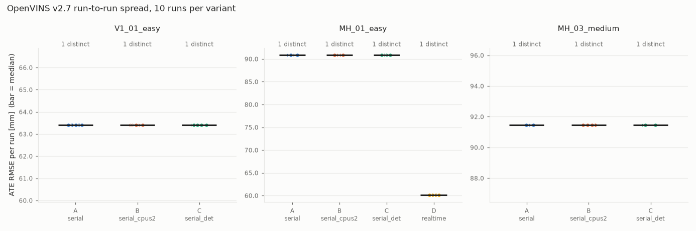

# Run-to-run variance of OpenVINS v2.7 (session S3)

**Result: under serial replay, OpenVINS v2.7 is bit-for-bit deterministic on this machine.**
In each of the 90 serial runs (3 sequences x 3 variants x 10 runs) the trajectory file was
byte-identical to every other run of that sequence. ATE and RPE spread is exactly 0. None
of the three knobs (fixed `--cpus`, single-threaded OpenCV, no publisher thread) shrinks a
spread, because there is none to shrink, and none of them introduces one. Realtime replay
(`rosbag play`) was also repeatable in 10/10 runs, but it gives a **different** answer
from serial (MH_01 ATE 60.1 mm vs 90.9 mm). Replay mode is part of the system under test
and must be pinned. **0 of 100 runs failed.**

Thresholds are deliberately not chosen here (see "Implications" at the end).

- Image `vioreg-openvins:v2.7` `sha256:f08eacb146ff…`, OpenVINS `93adc241` (tag v2.7)
- Config `euroc_mav`: hash `5adca0e7…` (estimator + kalibr imu + imucam, see README); variant C `46909d9b…`
- Harness `04fdb3c` (clean); Codespace with 4 cores and 16 GB; 2026-11-13/14
- ATE: posyaw, `skip_s` from `configs/thresholds.yaml` (V1_01 0, MH_01 40, MH_03 15); RPE: delta 1 s
- Data: `baseline.json` (variant A only), `variance.json` (all variants, every run), `spread.png`



## Variants

All variants use the same image, bag and `bag_start` (upstream's per-sequence values from
`serial.launch`: V1 0, MH_01 40, MH_03 17.5 s), with 10 runs each, run back to back with
the machine otherwise idle.

| Variant | What changes | Why it could matter |
|---|---|---|
| A_serial | `serial.launch`, image config (baseline) | `ros1_serial_msckf` reads the bag itself and forces `use_multi_threading_subs=false`, so image updates are synchronous with the IMU feed |
| B_serial_cpus2 | A + `docker run --cpus=2` | CPU quota changes thread timing |
| C_serial_det | A + `num_opencv_threads: 1` and `multi_threading_pubs: false` | `cv::parallel_for_` worker threads do not share `cv::setRNGSeed(0)`. Upstream marks pubs threading as a repeatability hazard (`ros1_serial_msckf.cpp:67`). Confirmed applied via OpenVINS's DEBUG printout: threads 1 / pubs 0 / subs 0, against the default 4 / 1 / 0 |
| D_realtime | `subscribe.launch dobag:=true`, `rosbag play -r 1` | the estimator consumes topics in real time on an async update thread (`use_multi_threading_subs=true`) |

**Seed settings:** the config exposes none for real data. `sim_seed_state_init`,
`sim_seed_preturb` and `sim_seed_measurements` only feed the simulator.
`cv::setRNGSeed(0)` is hard-coded in `VioManager.cpp:67`. Variant C is therefore the closest
available "determinism" setting.

D was run on MH_01_easy only: it plays at 1x, so 10 runs take about 25 min per sequence.

## Results

| Variant | Sequence | OK | Distinct trajectories | ATE median [mm] | ATE range [mm] | RPE median [mm] | Min coverage | Wall [s] median [min–max] |
|---|---|---|---|---|---|---|---|---|
| A_serial | V1_01_easy | 10/10 | 1 | 63.408 | 0.000 | 44.402 | 0.968 | 48.4 [47.9–53.3] |
| A_serial | MH_01_easy | 10/10 | 1 | 90.919 | 0.000 | 26.387 | 0.973 | 44.1 [43.3–48.2] |
| A_serial | MH_03_medium | 10/10 | 1 | 91.462 | 0.000 | 46.291 | 0.979 | 37.7 [36.9–38.5] |
| B_serial_cpus2 | V1_01_easy | 10/10 | 1 | 63.408 | 0.000 | 44.402 | 0.968 | 48.6 [48.0–49.4] |
| B_serial_cpus2 | MH_01_easy | 10/10 | 1 | 90.919 | 0.000 | 26.387 | 0.973 | 45.2 [43.7–45.7] |
| B_serial_cpus2 | MH_03_medium | 10/10 | 1 | 91.462 | 0.000 | 46.291 | 0.979 | 38.5 [37.7–38.8] |
| C_serial_det | V1_01_easy | 10/10 | 1 | 63.408 | 0.000 | 44.402 | 0.968 | 50.4 [49.6–51.4] |
| C_serial_det | MH_01_easy | 10/10 | 1 | 90.919 | 0.000 | 26.387 | 0.973 | 47.7 [47.3–48.1] |
| C_serial_det | MH_03_medium | 10/10 | 1 | 91.462 | 0.000 | 46.291 | 0.979 | 39.1 [38.8–39.9] |
| D_realtime | MH_01_easy | 10/10 | 1 | 60.086 | 0.000 | 26.784 | 0.973 | 151.6 [151.5–151.8] |

"Distinct trajectories" counts unique sha1s of the `run<k>.tum` files. Within each
sequence, A, B and C produce **the same** file (MH_01 `88e96c4f…`, V1_01 `8560e375…`).
The S1 run from earlier in the session (`results/s1`, a different harness commit) has the
same sha1 too.

## Answers

**Does the spread shrink with serial replay?** There is nothing to shrink: serial replay
already gives zero spread (1 distinct trajectory in 10 runs, on all 3 sequences). Against
the non-serial alternative (D), serial is not "less noisy" but **different**. D was also
repeatable here (1 distinct in 10), yet it lands 30.8 mm lower in ATE on MH_01 with 16 more
matched poses. In realtime mode the update runs on an async thread, so which IMU samples
precede each image update depends on scheduling. On an idle 4-core machine that schedule
happened to be stable. Under CPU contention (a shared CI runner) it would not be, which we
did not test. Serial removes that dependency by construction.

**Does a fixed `--cpus` shrink it?** No; the spread stays 0 and the output stays
byte-identical to A. It only shifts wall time (+0.2 to +1.1 s median).

**Do the seed and threading settings shrink it?** There are no real-data seeds. The
threading knobs (variant C) keep the spread at 0 and the output byte-identical to A, so
OpenCV's thread pool and the publisher thread do not perturb serial results in this image.
They cost +1.4 to +3.6 s of wall time.

**How many of the runs diverged or failed?** 0 of the 30 baseline runs (A), and 0 of all
100 runs. No run had `ok=false`, coverage was at least 0.968, and nothing diverged. ATE
stayed at 60–92 mm on every sequence.

## Is "one bad run fails the whole sequence" a sane gate policy?

On this evidence, yes, and more strongly than when it was written. With deterministic
serial replay, run-to-run noise is exactly zero, so a failed run cannot be "bad luck on
one of N". It is either:
1. a real behaviour change: but then every run would fail identically, and the policy
   changes nothing; or
2. an infrastructure fault (container crash, killed process, disk full): exactly what a
   gate should surface rather than average away.

In neither case would a median or a "k of N" rule be more correct. The policy would only
become noisy if non-determinism appeared, and that is itself a regression worth failing on.

## Implications for S4 (not decided here)

- **Repeat runs carry no information for serial replay on a fixed host.** 10 runs equal 1
  run. Two runs per sequence would be enough to *detect* determinism breaking (the 2 runs
  differ). That would cut nightly VIO time by about 5x.
- `vioreg.gate.threshold_from_baseline` (median + 3·MAD, or median·1.15, floor 10 mm) with
  MAD = 0 reduces to **median x 1.15**. Its noise term contributes nothing here, so the
  margin has to be justified on its own terms, for example by cross-host differences.
- **Not yet measured: cross-host determinism.** Bit-identity was shown on one Codespace.
  A GitHub-hosted runner may use a different CPU (SIMD paths, for example AVX2 vs AVX-512)
  and produce slightly different floats. The baseline should be re-run on the CI runner
  before thresholds are set.
- **Pin `MODE=serial` in CI.** Realtime replay changes the answer by about 30 mm on MH_01.
- MH_03: upstream `bag_start` is 17.5 s while `skip_s` is 15 s; coverage is still 0.979,
  above the 0.95 floor.

## Reproduce

```bash
bash scripts/experiments/variance.sh MH_01_easy 10     # also runs D_realtime
bash scripts/experiments/variance.sh V1_01_easy 10
bash scripts/experiments/variance.sh MH_03_medium 10
python -m vioreg.variance --seqs V1_01_easy MH_01_easy MH_03_medium --out-dir docs/variance
```

Each sequence script checks disk before fetching (it refuses below 2 GB at peak), fetches
one sequence, runs the variants, scores them, and deletes the raw bag. It keeps the
`.tum` files, error arrays, and ground truth.
